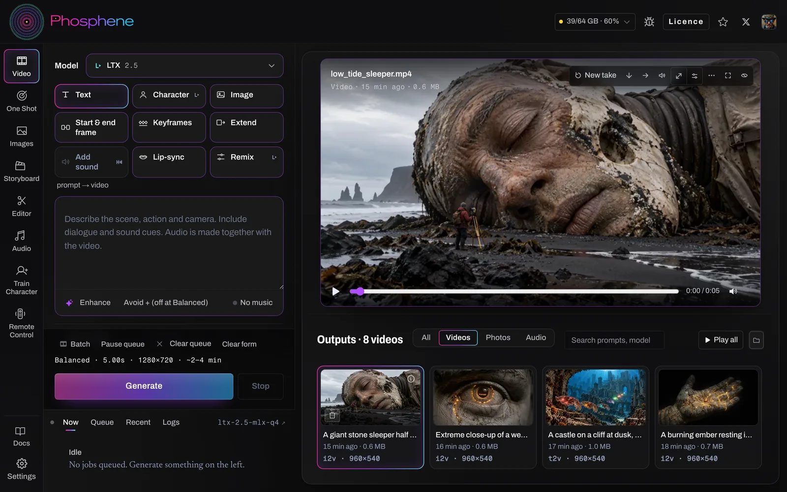
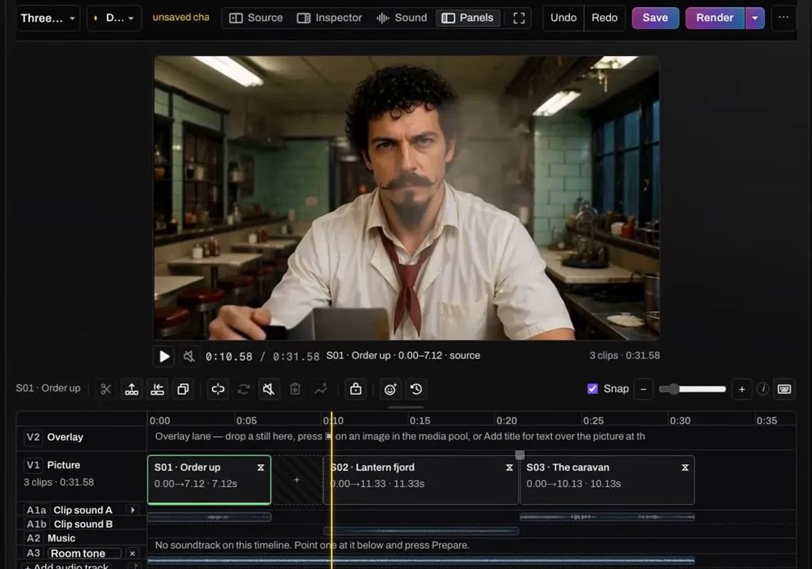
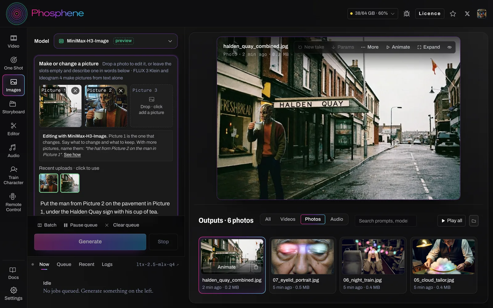
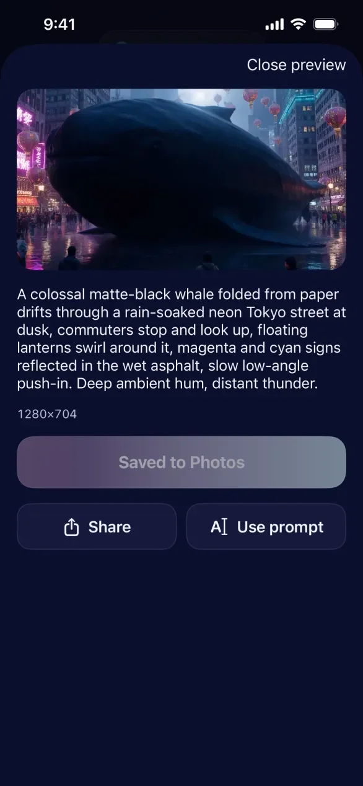

# Phosphene: free local AI video generator for Mac

**Phosphene is a free, open-source Mac app that makes AI video with sound, pictures, songs and speech on your own Apple Silicon Mac.** It runs LTX-2.5, MiniMax H3 (Hailuo H3) and MiniMax-H3-Image locally with MLX: offline, no cloud, no API key, no account, no NVIDIA GPU.

**Current release: v5.0.20.** Mac app or Pinokio · M1 to M5 · from 16 GB of memory · MIT licence · made by Mr Bizarro

<p align="center">
  <a href="https://phosphene.video/?utm_source=github&amp;utm_medium=readme&amp;utm_campaign=home&amp;utm_content=hero"></a>
</p>

<p align="center">
  <a href="https://phosphene.video/download/?utm_source=github&amp;utm_medium=readme&amp;utm_campaign=download&amp;utm_content=hero"><b>Download for Mac</b></a> ·
  <a href="https://phosphene.video/features/?utm_source=github&amp;utm_medium=readme&amp;utm_campaign=website&amp;utm_content=hero-features">See every feature</a> ·
  <a href="https://phosphene.video/mac-requirements/?utm_source=github&amp;utm_medium=readme&amp;utm_campaign=website&amp;utm_content=hero-requirements">Will my Mac run it?</a> ·
  <a href="https://phosphene.video/docs/?utm_source=github&amp;utm_medium=readme&amp;utm_campaign=docs&amp;utm_content=hero">Docs</a>
</p>

## At a glance

- **What it makes:** text-to-video and image-to-video with sound, lip-sync, long single shots, multi-shot films, an editing timeline, AI images and image editing, songs with vocals, text to speech, trained characters.
- **Models:** LTX-2.5 (Lightricks), MiniMax H3 / Hailuo H3, MiniMax-H3-Image, P-H3-Image, FLUX.2 [klein], FLUX 3 Klein, Qwen-Image-Edit, Ideogram 4, YuE2, Qwen3-TTS, Gemma.
- **Runs on:** Apple Silicon Macs, M1 to M5, from 16 GB of unified memory. Not Intel Macs, not Windows.
- **Installs as:** a native Mac app, or one click through Pinokio.
- **Costs:** free, with no credits, watermark or per-render charge. Optional Pro funds the project.
- **Privacy:** renders on your Mac. Prompts, pictures and videos are never uploaded.

## What you can make

### Video with sound: LTX-2.5 on Apple Silicon

Turn a prompt or a picture into a clip whose picture and sound are generated together, using the MLX port of Lightricks' LTX-2.5.
Modes: **Text**, **Image** (animate your picture, or take its character into a new shot), **Start & end frame**, **Keyframes** (3 to 8 frames), **Extend**, **Lip-sync** to your own voice or song, and **Remix**: **Motion Control** copies the motion and camera of a clip you give it ([guide](docs/MOTION_CONTROL.md)), **Ingredients** combines 2 to 8 reference pictures, **Colorize** turns black-and-white footage into colour, and **Upscale & Face Fix** sharpens a finished clip.
LTX-2.5 works from 16 GB of memory at smaller sizes and at full size from 48 GB. Since 5.0.20 a video on a 16 GB Mac peaks at about 5.7 GB of memory (it was 9 GB), and a render with LoRAs at about 6.7 GB (it was 19 GB), with the same frames as before.

<p align="center">
  
  
</p>
<p align="center"><sub>“Stone eye, gold tear” (image to video) and “The Drowned Ballroom” (text to video), LTX-2.5. Every clip on this page was rendered on one Mac with Phosphene.</sub></p>

### People who talk: MiniMax H3 (Hailuo) locally on a Mac

MiniMax H3, also called Hailuo H3, is Phosphene's second video engine, for scenes where people speak: dialogue, voices and sound come out of one pass, with lips that match.
It does text and image to video, start and end frames, keyframes, Extend up to 15 seconds, lip-sync, and **Add sound**, which gives a silent clip its own soundscape.
Since 5.0.7 it runs from **16 GB** of memory: Draft and Standard from 16 GB, High from 18 GB; Clean up sound and 10 and 15-second chained clips need 36 GB.
It is an optional download of about 75 GB (allow about 100 GB free while it installs), inside the Mac app or from the Pinokio sidebar.
Its licence does not cover the EU, the UK, South Korea or the US.

<p align="center">
  
  
</p>
<p align="center"><sub>“The mirror blinks late” and “The low-tide sleeper”, MiniMax H3, image to video</sub></p>

### Films: One Shot, Storyboard and the Editor

- **One Shot:** one continuous shot of 30 seconds to 2 minutes that never cuts.
- **Storyboard:** describe a film in a sentence; a local model writes the shot list, you edit it, draft every shot small and fast, then finish only the takes you keep. Add a song and it cuts a music video to the beat.
- **Editor:** a real timeline with trims, splits, J and L cuts, music, titles and transitions. Render one file, or export the timeline to DaVinci Resolve, Premiere Pro or After Effects.
- **Make it vertical:** a 9:16, 4:5 or square copy of any clip, in the More menu.

<p align="center">
  
</p>
<p align="center"><sub>The Editor: takes from any engine on one timeline, with their own sound, music and room tone.</sub></p>

### Pictures and image editing: MiniMax-H3-Image and more

The Images tab makes stills and edits them in plain words, then sends any picture straight to video.

- **MiniMax-H3-Image** (MiniMax): detailed pictures from a descriptive prompt at 4, 8 or 16 megapixels. **New in 5.0.19, it edits your pictures:** drop a photo in, say what to change, combine up to 6 pictures in one edit, or change the shape and let it fill the new area. Free, a preview; needs Hailuo H3 installed.
- **P-H3-Image** (Pruna AI, built on MiniMax H3): large photographs and posters with words spelled right.
- **FLUX.2 [klein]**, the light first model, and **FLUX 3 Klein** (Black Forest Labs): pictures from words or from your reference pictures.
- **Reference Edit** (Qwen-Image-Edit): change a background or an outfit, or combine up to three references.
- **Ideogram 4:** readable words placed where you want them on a picture.

<p align="center">
  
</p>
<p align="center"><sub>Combining pictures with MiniMax-H3-Image: Picture 1 (the street) plus Picture 2 (the man) becomes one photograph. About 8 minutes for two pictures at Draft on an M4 Max with 64 GB.</sub></p>

<p align="center">
  
</p>

### Songs, speech and lip-sync

- **Music Studio** writes a full song with vocals and instruments from your lyrics and a style with YuE2, or an instrumental. Make another take, cover a song, or get the score. About 11 GB, from 16 GB of memory.
- **Speech** turns a script into a spoken voice with Qwen3-TTS: nine preset voices with a delivery you describe, or a voice you have permission to use. About 6 GB, from 16 GB of memory.
- **Lip-sync** makes a face in a picture talk or sing to your track, on LTX-2.5 or MiniMax H3.

<p align="center">
  
  
</p>
<p align="center"><sub>“Neon Mile”, a Music Studio song sung with MiniMax H3, and “The bust sings”, LTX-2.5 lip-sync</sub></p>

### Characters and LoRAs

Train a character LoRA on your Mac from 15 to 50 of your own photos, of an original character or of yourself, then put it in any LTX shot. Gemma writes the training captions locally.
Training needs 24 GB; the graded High recipe runs on 64 GB or more. Browse and install LTX and H3 LoRAs inside the app.

## Mac requirements

**Will it run on your Mac?** The full answer for every memory size, with measured clip times per chip: [phosphene.video/mac-requirements](https://phosphene.video/mac-requirements/?utm_source=github&utm_medium=readme&utm_campaign=install).

Any Apple Silicon Mac from M1 to M5: MacBook Air, MacBook Pro, iMac, Mac mini, Mac Studio. Memory decides what you can run, and Phosphene only offers what your Mac can handle.

| Memory | What you can make |
| --- | --- |
| **16 GB** | LTX-2.5 video at smaller sizes, MiniMax H3 Draft and Standard (High from 18 GB), FLUX.2 [klein] pictures, songs, speech |
| **24 GB** | Also image editing with Reference Edit, FLUX 3 Klein and Ideogram 4, and character training |
| **32 GB** | Also P-H3-Image |
| **36 GB** | Also MiniMax-H3-Image, long chained H3 clips and Clean up sound |
| **48 to 64 GB** | Also LTX-2.5 at full size, High quality, Keyframes, Extend, trained characters |
| **96 GB and up** | Larger keyframe and extend sizes; no size limits from 120 GB |

**Disk:** setup itself downloads no models and needs 18 GB free. LTX-2.5 video is about 27.5 GB; MiniMax H3 about 75 GB; songs about 11 GB; speech about 6 GB; image models download on first use. In the Mac app the models can live on an external drive: choose the folder at setup or later in Settings.
The [Mac requirements page](https://phosphene.video/mac-requirements/?utm_source=github&utm_medium=readme&utm_campaign=website&utm_content=requirements) answers it for your exact chip and memory, with render times measured on Macs like yours.

## Install

**Mac app (recommended):** [download Phosphene for Mac](https://phosphene.video/download/?utm_source=github&utm_medium=readme&utm_campaign=install&utm_content=mac-app), open it, review the setup plan, and pick the models you want. It updates itself, and it reuses models a Pinokio install already downloaded.

**Pinokio:** Phosphene also installs with one click through [Pinokio](https://pinokio.computer), a free app launcher:

1. Install Pinokio.
2. Open **Discover → Download from URL** and paste `https://github.com/mrbizarro/phosphene`.
3. Press **Install**, then **Start**, then open the app.

To update in Pinokio, press **Update**, then restart Phosphene.
The [install guide](https://phosphene.video/docs/install/?utm_source=github&utm_medium=readme&utm_campaign=docs&utm_content=install) covers disk space, updates and troubleshooting. To install by hand, follow the [manual install](docs/MANUAL_INSTALL.md). Linux on Apple Silicon ([`docs/LINUX.md`](docs/LINUX.md)) is a community port maintained by @joshuaswarren on a best-effort basis.

## iPhone Remote

**Phosphene Remote** is the iPhone app that drives your Mac's studio: write prompts, run every Studio workflow, watch progress and save finished clips to your phone, at home or away. The Mac does the rendering. It is part of Pro: a Pro licence turns it on.

<p align="center">
  
</p>
<p align="center"><a href="https://phosphene.video/remote/?utm_source=github&amp;utm_medium=readme&amp;utm_campaign=remote&amp;utm_content=remote-section">About Phosphene Remote</a> · <a href="https://apps.apple.com/app/phosphene-remote/id6827562294">App Store</a></p>

## Free and Pro

Phosphene is open source under MIT and stays free. Every engine and feature available today stays free, and new model ports reach everyone free.

**Pro** is how the project is paid for. It funds the model ports, the testing on real Macs and the long hours behind every release. In return, Pro members get new speed-ups first, plus:

| Pro | What it does |
| --- | --- |
| Faster LTX clips | About a quarter less waiting on a 5-second LTX-2.5 clip (152 s on Free, 113 s on Pro, same clip and seed, M4 Max 64 GB). On 16 to 24 GB Macs, clips are 27 to 30% faster. Every Mac from 16 GB |
| Faster H3 picture-to-video | 5-second H3 clips: 14:57 on Free, 10:02 on Pro (M4 Max 64 GB). Macs with 36 GB or more |
| Faster Flex Turbo | Quicker H3 drafts, about 1.5x faster than Flex on Free. Macs with 36 GB or more |
| AI fill for Make it vertical | Paints real picture above and below instead of a blur. Macs with 48 GB or more |
| iPhone Remote | Drive the studio from your iPhone with the Phosphene Remote app |
| Priority support | Your bug reports and feature requests come first |

Pro is monthly or yearly, or Founding: one payment for three years of Pro, with nothing to renew. If you can't afford Pro, write to support@phosphene.video and you will get a free licence.
[Plans and measured speed-ups](https://phosphene.video/pricing/?utm_source=github&utm_medium=readme&utm_campaign=pricing&utm_content=pro-section).

## Agents, scripts and the API

Everything the app does is reachable over a local HTTP API ([`docs/API.md`](docs/API.md)), so a script or an AI agent can queue renders too.
Phosphene ships a `phosphene` command line tool and an MCP server for Claude Code, Codex or any MCP client; [`docs/AGENT_TOOLS.md`](docs/AGENT_TOOLS.md) has the setup:

```bash
python3 agents/phosphene_cli.py mcp-config   # prints the exact line for this install
claude mcp add phosphene -- python3 /path/to/phosphene/agents/phosphene_mcp.py
```

Agents can make video, images, speech and music, wait for jobs and fetch the files. There is also an image layout API for agents ([`docs/AGENT_API.md`](docs/AGENT_API.md)).

## How fast is it?

Median times across Phosphene users for a 5-second LTX-2.5 clip at Balanced, model loading included (opt-out usage counts, 10 August to 22 October 2026):

| Mac | Size | Median |
| --- | --- | --- |
| M4, 16 GB | 480p | 10:40 (36 Macs) |
| M4 Pro, 48 GB | 576p | 6:00 (30 Macs) |
| M4 Max, 64 GB | 576p | 3:00 (16 Macs) |

On an M4 Max with 64 GB, a 5-second MiniMax H3 clip at Standard with Fast takes about 5 minutes, and a MiniMax-H3-Image edit of one picture at Draft about 5 minutes.
Phosphene estimates the time before you press Generate, and **Bench** measures your own Mac. The [benchmarks page](https://phosphene.video/benchmarks/?utm_source=github&utm_medium=readme&utm_campaign=benchmarks&utm_content=speed-section) has every chip, updated with each release.

<p align="center">
  
</p>
<p align="center"><sub>“Lantern Fjord”, MiniMax H3, image to video</sub></p>

## FAQ

**Is Phosphene really free?**
Yes. No subscription, credits or watermark, and every feature available today stays free. Pro adds speed-ups first and iPhone Remote; it does not lock today's features.

**Does it work offline?**
Yes. Download the models once, then render without a connection. Online, it checks for updates and downloads only the models you ask for.

**Can I run LTX-2.5 or MiniMax H3 on an M1 or a 16 GB Mac?**
Yes. LTX-2.5 runs from 16 GB at smaller sizes on any Apple Silicon Mac, and MiniMax H3 runs from 16 GB at Draft and Standard (High from 18 GB). Smaller and older chips take longer.

**LTX-2.5 or MiniMax H3?**
MiniMax H3 for people talking: dialogue and voices that match lips. LTX-2.5 for everything else: more modes, keyframes, trained characters, Motion Control and the smallest Macs. Phosphene has both behind one switch.

**Can I turn a photo into an AI video on my Mac?**
Yes. Drop a picture into Image mode on LTX-2.5 or MiniMax H3 and describe what happens; the clip comes with sound.

**Do I need an API key, an account or an NVIDIA GPU?**
No. Phosphene runs open models on your Mac's own GPU through Apple's MLX.

**Does it run on Windows or Intel Macs?**
No. Phosphene is built for Apple Silicon only.

**Can I use what I make commercially?**
Phosphene's code is MIT. Each model has its own licence and some are non-commercial (see License). Check a model's licence before you sell its output.

## Privacy

No prompt, picture, video or filename is uploaded. The studio listens on `127.0.0.1` only, with no login, so don't expose it to a network.
Phosphene checks for updates and contacts Hugging Face or CivitAI only when you download models or LoRAs.
Anonymous usage counts (version, hardware class such as “M4 Max / 64 GB”, and render stats) are on by default; one click in Settings turns them off, and every field is listed in [`docs/ANALYTICS.md`](docs/ANALYTICS.md).
Make original characters, or yourself or others with documented consent; see the [acceptable use policy](https://phosphene.video/acceptable-use/?utm_source=github&utm_medium=readme&utm_campaign=acceptable-use&utm_content=privacy-section) and the [privacy policy](https://phosphene.video/privacy/?utm_source=github&utm_medium=readme&utm_campaign=privacy&utm_content=privacy-section).

## Contributing

Bug reports, ideas in Discussions and pull requests are welcome.
A report with your chip, memory, macOS version, Phosphene version and the error line is worth as much as a patch.
Contributors are credited in the release notes; see [CONTRIBUTING.md](CONTRIBUTING.md). What changed in each release is in the [changelog](https://phosphene.video/changelog/?utm_source=github&utm_medium=readme&utm_campaign=changelog&utm_content=contributing).

## Credits

- Lightricks for LTX-Video 2.x, and @dgrauet for ltx-2-mlx, the MLX port Phosphene builds on.
- MiniMax for Hailuo H3 and MiniMax-H3-Image, and Apple ML research for MLX.
- LightX2V for lightx2v v1.3, the adapter for Best on High; TaoLive (TaoMate-H3) and @kijai for the 3-step Fast adapter.
- Pika Labs (Mellis, Inc.) for Pika H3 Flex, a MiniMax H3 Model Derivative, downloaded from Pika's own Hugging Face repo at a pinned revision and converted on your Mac. Powered by MiniMax H3.
- Pruna AI for P-H3-Image.
- Black Forest Labs for FLUX 3 Klein and FLUX.2 [klein], mflux-community for its MLX conversions, and @filipstrand for mflux.
- The Qwen team for Qwen-Image-Edit and Qwen3-TTS, and mlx-audio for its MLX runtime.
- Multimodal Art Projection for YuE2, and @vanch007 for its MLX port.
- mlx-community for Gemma on MLX, and @cocktailpeanut for Pinokio.

Thanks to @blackest, @tanis2000, @joshuaswarren, @sahilkashyap64, @Morac2, @ybekocak,
@PhantombrainM, @Viktorminator, @Townesvz, @Sebartus, @mrapolo2020, @Techy2023,
and everyone who filed a bug.

## License

Phosphene's own code is MIT. The AI models are not part of this repo and each has its own licence; Phosphene shows a model's licence before download or first run when the licence requires it.

Ideogram 4, YuE2's weights, FLUX.1 Krea [dev] and Bria FIBO are non-commercial; YuE2 lets individual creators sell songs they make.
The MiniMax H3 licence does not cover the EU, the UK, South Korea or the US.
Check a model's licence before using its output commercially. The licence texts are in the [`LICENSES`](LICENSES) folder.

<p align="center"><sub><a href="https://phosphene.video/?utm_source=github&amp;utm_medium=readme&amp;utm_campaign=home&amp;utm_content=footer">phosphene.video</a> · <a href="https://phosphene.video/download/?utm_source=github&amp;utm_medium=readme&amp;utm_campaign=download&amp;utm_content=footer">Download for Mac</a> · <a href="https://phosphene.video/docs/?utm_source=github&amp;utm_medium=readme&amp;utm_campaign=docs&amp;utm_content=footer">Docs</a></sub></p>
