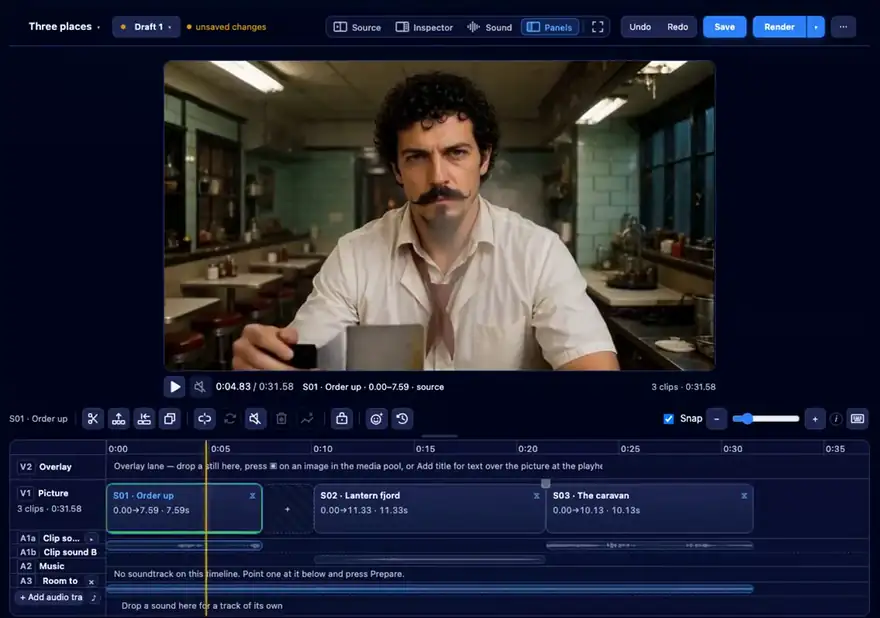
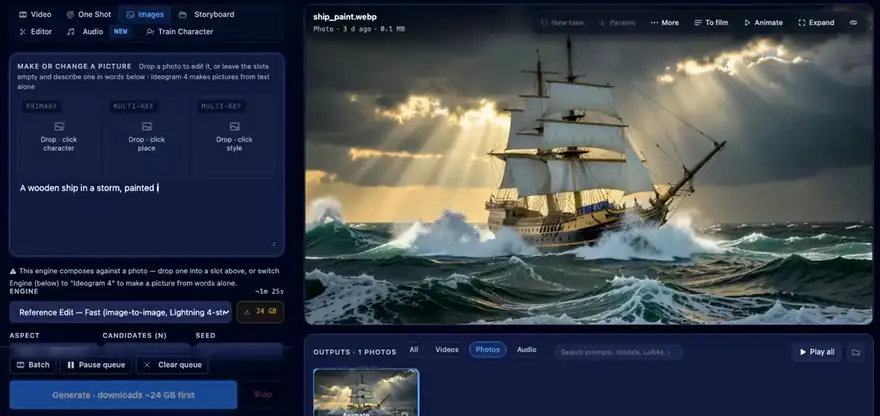
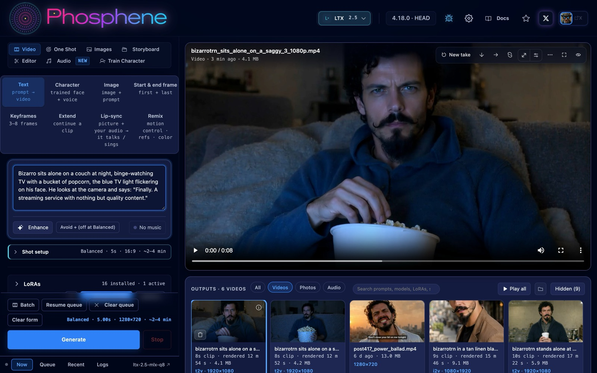

# Phosphene: free local AI video generator for Mac

**Run LTX-2.5 and MiniMax H3 (Hailuo) on your Apple Silicon Mac. Text-to-video and image-to-video with sound, lip-sync, songs and image editing. Offline: no cloud, no API key, no NVIDIA GPU.**

  

<h3 align="center"><a href="https://phosphene.video/?utm_source=github&amp;utm_medium=readme&amp;utm_campaign=repo&amp;utm_content=top">Visit Phosphene official site →</a></h3>

  

“The low-tide sleeper”, MiniMax H3, image to video. Every clip on this page was rendered on one Mac with Phosphene.

Phosphene is a free, open-source AI video generator that runs locally on a Mac with M1, M2, M3, M4 or M5.
It runs **LTX-2.5** and **MiniMax H3 (Hailuo H3)** for text-to-video and image-to-video with sound in the same pass,
**YuE2** for songs from lyrics, and **FLUX 3 Klein**, **Qwen-Image-Edit** and **FLUX.2** for images. It installs with one click through Pinokio
and is built on Apple's MLX: no CUDA, no cloud GPU, no API key, no credits and no watermark.
Your prompts, pictures and videos never leave your Mac.

**Current release: v4.19.15.** Made by Mr Bizarro.

## Why Phosphene

- **Free, with no credits.** No subscription, no sign-up, no watermark, no per-render charge. Make as many takes as you like.
- **Private and offline.** Rendering happens on your Mac. Download the models once, then work without a connection.
- **Sound comes with the picture.** Footsteps, rooms, voices and lip movement are generated together, not added later.
- **One app for the whole film.** Shots, long takes, songs, stills, trained characters and an editing timeline.
- **Made for the Mac.** Phosphene checks your memory and only offers what your Mac can run.

## What you can make

### Text-to-video and image-to-video with sound (LTX-2.5 on Apple Silicon)

Turn a prompt or a picture into a video clip with sound, using the MLX port of Lightricks' LTX-2.5. Set first and last frames, guide a shot with 3–8 keyframes,
**Extend** a clip, **Retake** one moment, or lip-sync a face to your own voice or song. Upscale & Face Fix is built in.
Works from 16 GB of memory.

  
  

“Stone eye, gold tear” and “Ember in a marble palm”, LTX-2.5, image to video

### Run MiniMax H3 (Hailuo) locally on a Mac

MiniMax H3, also called Hailuo H3, makes scenes where people talk, with lips that match their voices.
Use keyframes, extend a shot, lip-sync, or **Add sound** to give a silent clip its own soundscape.
**New, preview:** Pika H3 Flex, Pika Labs' six-step H3, as a Speed choice: about 2.2× faster than Best at the same size. As far as we know, the first Mac port.
About 75 GB, one click from the Pinokio sidebar, from 36 GB of memory.
Its licence excludes the EU, UK, South Korea and US.

  
  

“The mirror blinks late” and “The lung mender”, MiniMax H3, image to video

### Long AI films: One Shot, Storyboard and the Editor

- **One Shot:** one continuous shot of 30 seconds to 2 minutes that never cuts.
- **Storyboard:** turn one idea into a multi-shot film. Plan the shots, render them, keep the best takes, or turn on Auto. Add a song to cut a music video to the beat.
- **Editor:** trim, split, J-cuts and L-cuts, music, titles and transitions. Render one file or send the timeline to DaVinci Resolve, Premiere Pro or After Effects.

  

The Editor: trim the takes, add music and titles, then render or send the cut on.

### Remix your own footage

- **Motion Control:** copy the motion, camera move and pose of a clip you give it while your prompt paints a new subject and scene ([guide](docs/MOTION_CONTROL.md)).
- **Ingredients:** compose 2–8 reference pictures (a character, a prop, a place) into one clip.
- **Colorize:** turn black-and-white footage into colour.

  

“The Drowned Ballroom”, LTX-2.5, text to video

### Songs from lyrics with YuE2: a local Suno alternative

Music Studio uses YuE2 to write a full song with vocals and instruments from your lyrics and a style, or an instrumental.
Make another take, cover a song, or get the score. About 11 GB, installed inside the app, from 24 GB of memory.

  
  

“Neon Mile”, a Music Studio song sung with MiniMax H3, and “The bust sings”, LTX-2.5 lip-sync

### AI images with FLUX 3 Klein, Qwen-Image-Edit and FLUX.2

New in 4.19.14: FLUX 3 Klein by Black Forest Labs makes an image from a sentence in about 50 seconds on an M4 Max, or edits the reference pictures you give it.
Qwen-Image-Edit and FLUX.2 (via mflux) make images and edit them in words, like “make the jacket red”,
with up to three reference pictures. Ideogram 4 puts readable words on a picture. Send any still straight to video.

  

Images: describe the change, add up to three reference pictures, pick from four takes.

### Train a character LoRA on your Mac (face and voice)

Train an LTX-2 character LoRA of an original character, or of yourself, on your Mac: face from your photos, voice from your recordings.
Local Gemma writes the training captions for you. Browse and install LTX LoRAs from CivitAI inside the app.

  

Bizarro, a trained character, in the Video tab: the prompt, the take and the outputs.

### Scripts and AI agents

Everything the app does is reachable over a local HTTP API (`docs/API.md`), so Claude Code, Codex or your own script can queue renders.
There is also an image layout API for agents (`docs/AGENT_API.md`).
Gemma runs locally for prompt **Enhance**, captions and the storyboard planner.

## Mac requirements: M1 to M5, memory and disk

Any Apple Silicon Mac, M1 or newer, including MacBook Air, MacBook Pro, Mac mini and Mac Studio. Memory decides what you can run. Intel Macs and Windows are not supported.

| Memory | What you can make |
| --- | --- |
| 16–24 GB | LTX-2.5 video from text or a picture at smaller sizes, and images. Songs from 24 GB. |
| 32–36 GB | Everything above. MiniMax H3 from 36 GB. |
| 48–64 GB | LTX keyframes, Extend, trained characters with Q8 weights, and the High tier. |
| 96 GB+ | Most modes at full size (from 80 GB). Size limits come off at 120 GB. |

**Disk:** the first install downloads 27.5 GB before Start, then about 10.7 GB in the background.
MiniMax H3 (about 75 GB) and Music Studio (about 11 GB) are optional.

## How fast is it on a Mac?

On an M4 Max with 64 GB, a 5-second LTX-2.5 clip at High takes about 6 minutes,
a 5-second MiniMax H3 clip on Draft + Fast about 5 minutes, and a 3-minute song about 3 minutes.
Smaller Macs take longer: across Phosphene users, a 5-second LTX-2.5 clip at Balanced (480p) took a median 10m40s on a 16 GB M4.
Phosphene estimates the time before you press Generate. See render times by Mac.

  

“Lantern Fjord”, MiniMax H3, image to video

## One-click install with Pinokio

Phosphene installs with one click through Pinokio (pinokio.computer), a free app launcher:

1. Install Pinokio.
2. Open **Discover → Download from URL** and paste `https://github.com/mrbizarro/phosphene`.
3. Press **Install**.
4. Press **Start**, then open the app.

To update, press **Update** in Pinokio, then restart Phosphene.
The [docs](https://phosphene.video/docs/?utm_source=github&utm_medium=readme&utm_campaign=repo&utm_content=docs) have the step-by-step install, troubleshooting and every feature in detail.
To install by hand instead, follow the [manual install](docs/MANUAL_INSTALL.md).
Linux on Apple Silicon (`docs/LINUX.md`) is maintained by @joshuaswarren on a best-effort basis.

## What's coming

These open with **Phosphene 5.0**:

- **A Mac installer,** so you won't need Pinokio. It can reuse the models your Pinokio install already downloaded.
- **Pro,** for people who use Phosphene every day: new features and speed-ups first, Phosphene Remote to start and watch renders from your iPhone, and priority support. $15 a month or $120 a year.
- **Founding:** 3 years of Pro for one payment of $149, limited to 200 seats.

Nothing is on sale yet. [Get Phosphene for Mac and join the list →](https://phosphene.video/?utm_source=github&utm_medium=readme&utm_campaign=repo&utm_content=coming)
Everything available today stays free, Phosphene stays open source under MIT, and new model ports reach everyone free.

## FAQ

**Is Phosphene really free?**
Yes. No subscription, credits or watermark, and every feature available today stays free. Pro adds speed-ups and Remote; it does not lock today's features.

**Does it work offline?**
Yes. Download the models once, then render without a connection. When online, it checks GitHub for updates and downloads models you ask for.

**Can I run LTX-2 or MiniMax H3 on an M1, M2 or 16 GB Mac?**
LTX-2.5 runs from 16 GB at smaller sizes on any Apple Silicon Mac. MiniMax H3 needs 36 GB. The Mac requirements table above has the details.

**LTX-2.5 or MiniMax H3: which should I use?**
MiniMax H3 for people talking: dialogue and voices that match lips. LTX-2.5 for everything else: more modes, keyframes, trained characters, Motion Control and smaller Macs. Phosphene has both in one switcher.

**Are LTX-2.5 and MiniMax H3 open source?**
Their weights are open to download, each under its own community licence (see License below). Phosphene's code is MIT.

**Does it run on Windows or Intel Macs?**
No. Phosphene is built for Apple Silicon. On Windows with an NVIDIA GPU, look at ComfyUI or WanGP.

**Can I run Wan 2.2 or FramePack on a Mac?**
Phosphene doesn't include them. Draw Things lists Wan 2.2, and mlx-video runs Wan 2.1 and 2.2 from Python. Phosphene's LTX-2.5 and MiniMax H3 cover the same jobs with sound.

**What is the best local AI video generator for Mac? How is Phosphene different from ComfyUI, Draw Things or LTX Desktop?**
ComfyUI gives you a node graph for every model; Phosphene gives you ready-made workflows built on MLX for the Mac.
Draw Things has an App Store app and cloud compute; LTX Desktop comes from the makers of LTX.
Each is ahead of Phosphene somewhere; pick the one that fits how you work.

**Is it an alternative to Veo 3, Runway, Kling or Higgsfield?**
Those run in the cloud and charge per render. Phosphene runs open models on your own Mac for free. Cloud models are faster, and some are sharper; Phosphene is private, unlimited and yours.

**Can I use what I make commercially?**
Phosphene's code is MIT. Each model has its own licence, and some are non-commercial (see License below). Check a model's licence before you sell its output.

## Privacy

No prompt, picture, video or filename is uploaded. The app listens on `127.0.0.1` only, with no login, so don't expose it to a network.
Phosphene checks GitHub for updates and contacts Hugging Face or CivitAI only when you download models or LoRAs.
Anonymous usage counts (version, hardware class such as “M4 Max / 64 GB”, and render stats) are on by default;
one click in Settings turns them off, and every field is listed in `docs/ANALYTICS.md`.
Make original or stylised characters, or yourself with documented consent; follow the acceptable use policy on phosphene.video.

## Contributing

Bug reports, ideas in Discussions and pull requests are welcome.
A report with your chip, macOS version, Phosphene version and the error line is worth as much as a patch.
Contributors are credited in the release notes. See CONTRIBUTING.md.

## Credits

- Lightricks for LTX-Video 2.x, and @dgrauet for ltx-2-mlx, the MLX port Phosphene builds on.
- MiniMax for Hailuo H3, and Apple ML research for MLX.
- LightX2V for lightx2v v1.3, the adapter for Best on High; TaoLive (TaoMate-H3) and @kijai for the 3-step Fast adapter.
- Pika Labs (Mellis, Inc.) for Pika H3 Flex, a MiniMax H3 Model Derivative, downloaded from Pika's own Hugging Face repo at a pinned revision and converted on your Mac. Powered by MiniMax H3.
- Black Forest Labs for FLUX 3 Klein, and mflux-community for its MLX conversions.
- @filipstrand for mflux; Multimodal Art Projection for YuE2 and @vanch007 for its MLX port.
- mlx-community for Gemma on MLX, and @cocktailpeanut for Pinokio.

Thanks to @blackest, @tanis2000, @joshuaswarren, @sahilkashyap64, @Morac2, @ybekocak,
@PhantombrainM, @Viktorminator, @Townesvz, @Sebartus, @mrapolo2020, @Techy2023,
and everyone who filed a bug.

## License

Phosphene's own code is MIT. The AI models are not part of this repo and each has its own licence.
Phosphene shows a model's licence before download or first run when the licence requires it.

Ideogram 4, YuE2's weights, FLUX.1 Krea [dev] and Bria FIBO are non-commercial.
YuE2 lets individual creators sell songs they make. Hailuo H3's licence excludes the EU, UK, South Korea and US.
Check a model's licence before using its output commercially. The licence texts are in the `LICENSES` folder.
